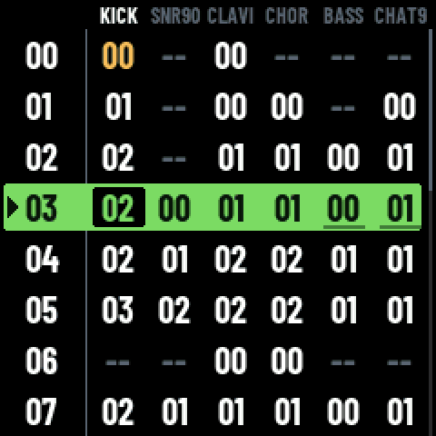
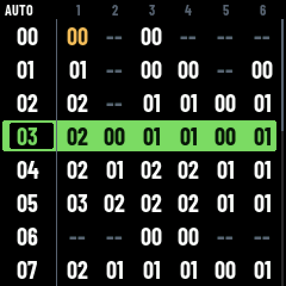
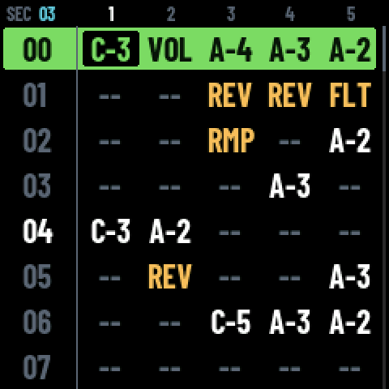
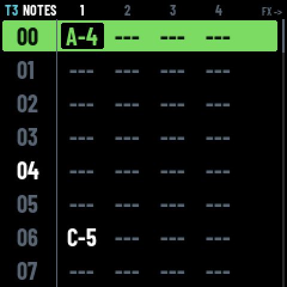
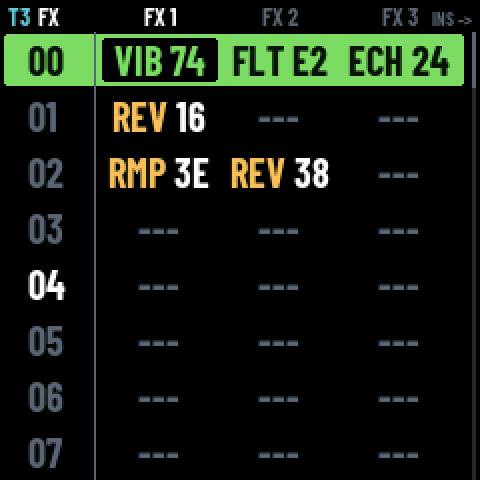
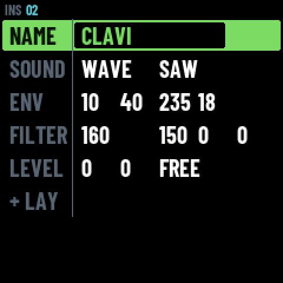
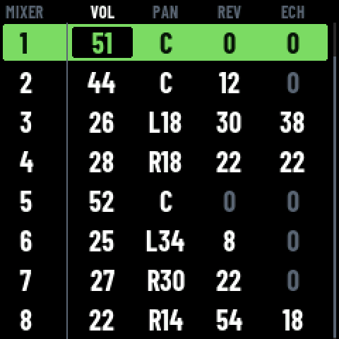

<p align="center">
  
</p>

<p align="center">
  <b>A tracker inside a pocket synth.</b><br>
  Firmware for the M-VAVE FM-1. Eight tracks, instruments you build yourself,<br>
  three effects a step, and songs that are text files.
</p>

<p align="center">
  <a href="https://moondaw.com/app/"><b>Try it in your browser</b></a> ·
  <a href="https://moondaw.com/manual.html">Read the manual</a> ·
  <a href="#install-it">Install it</a>
</p>

<p align="center">
  
</p>

The FM-1 leaves the factory as a machine you **play**. MOONDAW turns it into a
machine you **write** on. You put the notes down one at a time, listen, and fix
them, wherever you are, on something the size of a phone. You don't need to know
how to play: a song is carved, not recorded.

The browser version is the firmware itself, compiled as it stands, so you can
find out if you like it before touching your FM-1.

## Why you might like it

- **Nothing is hidden.** No tables, no hex: everything that decides the notes is
  on the step row in front of you, and effects have names like `VIB`, `REV`, `FLT`.
- **The screen is the manual.** The buttons that do something light up, and HELP
  has a page for every screen and every effect, on the device.
- **Your songs are yours.** A song is a plain-text `.trk` file you can read, edit
  in any text editor, diff, keep under git and send over USB.
- **It sounds like more than the box suggests.** Chip voices, your own samples, a
  voice that sings the syllables you write, drums, reverb, delay and a limiter,
  all on 512 KB of RAM and no floating point.

## A look around

Every picture here comes out of the firmware's own framebuffer
(`tools/readme_shots.mjs`).

<table>
  <tr>
    <td align="center"><br><b>SONG</b><br>the arrangement</td>
    <td align="center"><br><b>SECTION</b><br>every track at once</td>
    <td align="center"><br><b>PATTERN</b><br>up to four notes a step</td>
  </tr>
  <tr>
    <td align="center"><br><b>EFFECTS</b><br>three a step, by name</td>
    <td align="center"><br><b>INSTRUMENT</b><br>build your own</td>
    <td align="center"><br><b>MIXER</b><br>volume, pan, sends</td>
  </tr>
</table>

And a song, as it sits on the device:

```
pat t1 01 len 64
04 A-2 i04 fVEL7F fVOL76
05 --- fREV20
0C A-2 i04
14 A-2 i04
```

## What it does

- **Songs**: an arrangement of phrases (SONG), each phrase the blocks its
  tracks play (SECTION), each block its steps (PATTERN): up to four notes,
  an instrument and three effects a step, 8 tracks. The device holds 31 songs.
- **Sounds**: PULSE, NOISE and WAVE chip voices, SMPL (your own samples),
  VOX (a singing voice that sings the syllables you write) and DRUM
  (Felucca's drum voices), with an envelope, a filter, layers, reverb and
  delay sends, and a master limiter.
- **Writing**: the keyboard writes notes, REC records what you play over a
  count-in, a selection copies, pastes, cuts and clears, a loop plays a
  passage round, UNDO and REDO on the ALGO knob.
- **A MIDI keyboard**: its notes play the instrument of the screen you are
  on -- the one the cursor is on -- at the pitch the keyboard sends. The
  FM-1 is a USB device, not a host, so a keyboard either plays through the
  computer it is plugged into (`tools/fm1_midi.py` forwards it) or straight
  into the 3.5 mm MIDI jack, with no computer at all.
- **Playing**: MIXER (volume, pan, sends, mute and solo), per-cell levels
  in SONG, solo and mute from any screen with a track in front.
- **From a computer**: send and fetch songs over USB, and drive the device
  from a script (`tools/fm1_ctl.py`: read its state, press its buttons,
  write steps, capture its screen).

## Status

**Beta.** It is used every day on a real FM-1, but it has not been through many
hands yet. Bug reports from yours are very welcome.

## Install it

> [!WARNING]
> **Installing firmware on an FM-1 is at your own risk** and can leave it
> unable to start. Back up the stock flash first, and have
> [FM-1-transporter](https://github.com/kurogedelic/FM-1-transporter) ready to
> restore it.

- **In a browser**: `web/installer/` is a page that installs the firmware
  over USB from Chrome or Edge, with no tools to install; see
  `web/installer/README.md` for what it checks and its state.
- **From a terminal**: `python3 tools/fm1_install.py build/moondaw.fwsc`
  (Python 3 and `python-rtmidi`), after building (below) or with a released
  `moondaw.fwsc`.
- **A device that does not start**: `docs/ARRIVEE.md` walks through the
  first install, the backup and the rescue path that needs no extra
  hardware.

## Songs

```
python3 tools/fm1_send.py song.trk        # a song onto the device
python3 tools/fm1_send.py --list          # what is on it
python3 tools/fm1_send.py --get NAME -o song.trk   # a song back
```

## Samples

SMPL plays short one-shots read from the flash. They are prepared and sent
from the computer:

```
python3 tools/fm1_samples.py add kick.wav snare.wav   # into the bank
python3 tools/fm1_samples.py list                     # what is in it
python3 tools/fm1_samples.py remove tr9_kick          # one out
```

`add` takes any WAV and makes it what the device plays: mixed to mono,
resampled to 22 050 Hz, IMA ADPCM, the silence cut at both ends, a second
at most, normalised to -1 dBFS. A sample is named after its file, and a
song calls it by that name: `smp 00 tr909/tr9_kick.wav` plays the sample
named `tr9_kick`. A song carries its own instruments, so the zones that
spread samples across the keys travel in the `.trk`.

The bank is one file in the store, beside the songs, and it is rewritten
whole each time: a sample more is a song less, and SYSTEM on the device
says how much of each there is. A bank is taken on the home screen, as a
song is.

## Building

| Backend | Build | What it is |
| --- | --- | --- |
| FM-1 | `./build.sh` → `build/moondaw.fwsc` | the firmware (see `BUILDING.md`) |
| SDL2 | `make sim` → `build/sim/moondaw-fm1 [song.trk]` | the FM-1 simulated in a window |
| Browser | `make web` → `build/web/` | the same in an AudioWorklet |

`make test MOONDAW=<path to MOONDAW>` runs the screens, the store, the link
and the remote headless, and the song reader on real songs; `make difftest`
renders those songs through this engine and through MOONDAW's own and
compares them.

```
core/        the tracker: song model, .trk, player, engines -- freestanding C,
             no libc, no malloc, no float
app/         the screens, the USB link and the remote, the on-device help
platform/    platform.h and its SDL and web implementations
firmware/    the FM-1 implementation, on Felucca's HAL and drivers
tools/       build, package, install, transfer and remote-control tools
tests/       host tests and the differential test against MOONDAW
docs/        studies and notes; NOTES.md is the design diary
```

## Credits and licence

GPL-3.0-only (`LICENSE`): use it, study it, change it, share it.

MOONDAW stands on [Felucca](https://github.com/hugelton/Felucca), the open
firmware for the FM-1, without which none of this would run.

- The hardware abstraction, drivers, update loader and build tools are
  from [Felucca](https://github.com/hugelton/Felucca) by Leo Kuroshita
  (@kurogedelic), Hügelton Instruments, and so are the DRUM engine's voices
  (Felucca's own, GPL-3.0, with DSP helpers from Felucca-Engines, MIT).
  `UPSTREAM.md` lists every file taken and what was changed.
- The band-limited step table in `core/synth.c` is from blip_buf by Shay
  Green (LGPL-2.1-or-later), rewritten in 32 bits.
- The effects' help pages (`app/fx_help.c`) are MOONDAW's own text, PRB's apart.
- Fonts: Barlow Condensed and JetBrains Mono (SIL Open Font License),
  font8x8 (public domain).
- Three Apache-2.0 files from JieLi's AC79 SDK are in the package.

Every third-party licence is in `LICENSES/`.

## The name

"MOONDAW" is the name of this project and belongs to its author. The GPL grants
no rights to it: forks are welcome, under another name.

"M-VAVE" and "FM-1" are trademarks of their respective owners. MOONDAW is an
independent firmware, not affiliated with or endorsed by them.
